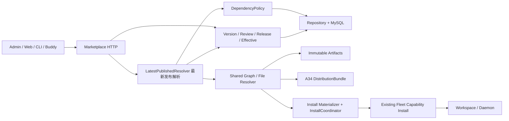

# Marketplace 独立资产引用与发布：完整技术方案（B 模型）

状态：**最终决策已锁定（2026-10-26）**。引用模型为 **B**：Expert→Skill、Team→Expert 的依赖版本在每次读取/安装时解析目标资源的**当前正式发布版**；`target_version_id` 只保留为上次解析/审计值，不是公共读取、审核观察、A34 或安装的解析依据。A09 restore-to-draft、A29/A30 HTTP 迁移、同名/多版本共存（`mk1` 别名、`SKILL.md`/frontmatter 改写）、`installation_name` 均已撤回或明确不做；"private 一律禁止"、"曾发布即禁止删除"不再是本期规则。规则以[最终决策](00-decisions.md)为准，跨服务 wire 见[API 契约](02-api-contracts.md)，执行拆分见[issues](issues/README.md)。本文与 00 冲突时以 00 为准。本文不表示源码已实现任何一条。

## 1. 目标、范围和非目标

**已确认核心：将内含资产改为独立市场资产引用；Expert→Skill、Team→Expert 保存目标 ID，版本在读取/安装时解析目标当前正式发布版；Connector 仍按 ID 引用有效态，不新增业务版本。** 保存快照、依赖校验、版本图读取、现有审核、安装、删除保护和显式迁移只围绕该模型改造；不重设计现有权限、审核、上下架、删除或 Admin 操作。

源码改造涉及 `octo-marketplace`、`octo-admin`、`octo-web`、`octo-cli`、`octo-buddy-client`；`octo-fleet` 仅作为现有原子安装服务的联调依赖，本期不修改其源码、API、数据库或清理策略。`octo-server` 继续负责身份/Space 权限；`octo-plugin-lib` 继续负责 Manifest/Package/Hash/端点类型，不修改通用 Relation Schema。Buddy Daemon 不承担市场解析，不新增工作空间绑定模型。

不包含：新增安全状态、隐藏/重新上架流程或接口、下架依赖安装豁免、新取证授权模式、运行中实例强停、自动同步已安装 MCP、团内覆盖成员能力、新 Secret 管理系统、二进制技能支持、脚本自动改写、自动执行生产迁移；也不做同名/多版本共存、A09 恢复、A29/A30 HTTP 迁移、Fleet/Daemon 改造。不支持的输入明确拒绝，不能静默损失内容。

### 1.1 市场源定义、工作空间实例与纯本地资源

- 市场发布：Expert 只能引用市场中的 Skill ID（版本在读取/安装时解析为当前正式发布版）；不接受本地路径或 Fleet skill_id 替代市场身份。要发布含本地 Skill 的组合，先将 Skill 显式发布到市场，再发布引用它的 Expert，不能内嵌上传。
- 纯本地：Expert 与 Skill 都在本地时，组合、修改和执行不调用 Marketplace，不受市场依赖发布规则管理。
- 工作空间定制：用户编辑 Fleet 中的 Expert 实例，选择本地 Skill 时，Buddy 读取实际 SKILL.md 及完整支持文本文件，直接创建/更新目标 Workspace 的 Fleet Skill，再使用 Fleet skill_id 绑定实例；不创建 Marketplace Plugin/private Skill，不改变源市场 Expert 的版本或关系。
- 运行资源与市场身份分开：本地路径不是远端可用引用，必须传完整内容；市场 plugin_id/version_id 也不是 Fleet skill_id。更新既有共享 Fleet Skill 会影响其他绑定者，不能擅自覆盖；若仅当前 Expert 需要改动，应创建工作空间副本再绑定。
- 现有 Fleet 可创建 Skill 及其 files、全量替换或增量增加 Expert 的 skill_ids；这些是既有运行态管理能力，不是本需求新增 Marketplace API。Skill 上传和绑定现有实例不是同一个跨调用原子事务，上传失败不能宣告绑定成功；按既有 Fleet/Daemon 机制生效，不承诺正在运行的会话即时热更新。
- 这是职责边界确认，不代表 Buddy 已有全部"选择本地目录→推送→组合"的 UI，也不扩大当前市场 issue 为新的工作空间编辑器实现任务。

### 1.2 B 模型的代价（必须写入 API/客户端说明）

- 同一个 Expert/Team 版本，不同时间读取/安装可能拿到不同依赖内容；A34 `bundle_digest` 因此是动态值，不能当内容寻址、长期缓存键或"内容未变"的证据。
- 审核只能保护审核窗口，不能冻结批准后的依赖内容。
- 依赖（Skill/Expert）发新版可能影响引用方；本期仅记录审计并展示当前解析版本，不因依赖更新主动发送通知，不新增通知任务或推送协议。
- 安装可复现性只保证"同 key 重试首次冻结 plan"；新 key 新安装按最新解析。
- "最新"是唯一显式规则，不是失败回退：目标不可用即整体失败，不补 latest、不切历史版本、不删边、不降级。

## 2. 结构与唯一权威



沿用 Handler → Service → Repository。集中逻辑只有：最新发布解析、依赖策略、快照 codec、图/文件解析、安装身份及协调。A01 公共过滤、A03 图、A34 完整内容、安装和审核观察必须复用同一个最新发布解析服务，不能各自写一套 SQL 或各自补 latest；安装物化与 Fleet 序列化留在解析之后。

| 内容 | 权威 |
|---|---|
| 当前身份、owner/Space/visibility、listing | `plugins`，沿用现有鉴权和状态动作 |
| Skill/Expert/Team 内容、附件与关系集合 | `plugin_versions` 不可变快照 |
| 最近保存 | `plugins.current_version_id` |
| 当前正式发布 | `plugins.published_version_id` + 对应 release |
| 曾正式发布证明 | `plugin_version_releases` |
| 依赖的权威版本 | 读取时解析目标的 `plugins.published_version_id`；**不是**快照里的 `target_version_id` |
| current 编辑关系 | `plugin_relations`；不是已发布图 |
| 发布/历史关系查询 | 快照 `relations_json`；refs 为同事务生成的投影，`target_version_id` 仅审计 |
| Connector 有效内容 | `plugin_connector_effective` 的单行有效投影，不是业务 Version |
| 审核观察的依赖版本 | `plugin_review_requests` 冻结的 observations；只保护审核窗口 |
| 单次安装内容 | `plugin_install_attempts` 引用的不可变无凭据计划（首次冻结） |
| Fleet 是否提交成功 | 现有 Capability POST 的正常响应或同键同完整请求回放；无新增只读查询 |

### 2.1 最新发布解析服务（唯一解析入口）

- 可用定义：目标 `published_version_id` 非空，且 `status=1`、`deleted_at IS NULL`、`listing_state='published'`。不满足即依赖不可用，**不回退旧版本**。
- 一次请求（A01/A03/A34/安装/审核观察）在同一数据库一致性快照内解析完整图，避免"列表显示 v2、安装用 v3"。
- 解析结果按 `plugin_id@version_id`（Connector 为 `plugin_id@effective_revision`）标识；解析不读 current、不读软删数据、不按名称/内容匹配。
- 任一节点不可用即整图不可用：公共列表隐藏来源、A34/安装整体失败、人工审核返回 `dependency_changed`；不裁剪、不跳文件、不删边。
- Team 递归：Team → 成员 Expert 当前正式发布版 → 该 Expert 的当前正式发布版 Skill/Connector；任一节点不可用整图不可用。Team 边的 `member_key/role/is_leader/sort_order` 仍由 Team 快照决定，不随成员 Expert 发新版变化。
- 图/文件预算按 02 §2.4/§6.1：1500 节点（含根）、2000 边、16MiB 等，按解析后的资源＋版本/有效修订计数。
- `target_version_id` 只能在解析完成后写入"上次解析/审计"字段，不能反向参与解析、可用性判定、删除保护、A34、安装或审核比对。

## 3. 数据模型

### 3.1 增量模型

复用已有表和主键类型。现有 `plugin_versions.version` 是保存序号，不把它重解释为发布 SemVer。

| 表 | 字段/约束 | 写入者 |
|---|---|---|
| plugins | 新增 `published_version_id` nullable、`edit_revision` bigint（从 1 开始）、`declared_visibility`；`current_version_id` 是最近保存，`visibility` 是当前有效受众，`declared_visibility` 是编辑拟定受众；不新增分发/可用性状态列 | 既有保存/发布动作接入版本事务 |
| plugin_versions | 保留 `manifest_json`/`plugin_json`/`attachment_keys_json`/`relations_json`；新增 `version_label`、`revision_no`、`declared_visibility`、`content_digest`；`unique(plugin_id,revision_no)`。不新增 `restored_from_version_id`（A09 撤回） | 内容、关系集合、候选标签或拟定受众变化均写新快照；只有完整冻结输入一致的普通重复保存才复用 current |
| plugin_version_releases | `plugin_id`、`version_id`、`version_label`、`released_at`、`released_by`；`unique(version_id)`、`unique(plugin_id,version_label)` | 发布事务 |
| plugin_relations | `target_version_id` nullable，语义为"上次解析/审计值"，可省略/为 null；Connector 关系必须完全省略；保留 `relation_id`/`sort_order`/`data` | current 全量关系同步 |
| plugin_version_relation_refs | `source_plugin_id`/`source_version_id`、`relation_id`/`type`、`target_plugin_id`、`target_version_id` nullable；`PK(source_version_id,relation_id)`，索引 `target_plugin_id`、`target_version_id`；`target_version_id` 不参与可用性和删除保护判定 | 与快照同事务，仅插入/重建，无业务独立修改 |
| plugin_connector_effective | `plugin_id` PK、`effective_revision` bigint、`effective_digest`、`manifest_json`、`plugin_json`、`attachment_keys_json`、`activated_at`；只保存最近批准的完整有效内容 | Connector 发布/批准事务 |
| plugin_review_requests | `source_version_id` nullable、`source_edit_revision`、`frozen_content_digest`、`connector_observations_json`、`resolved_dependency_observations_json`（提交时解析到的 Expert/Skill 版本与该 Expert 的 Connector 观察，字段名以实现时与 02 同步为准）、`baseline_version_id` 及 `dependency_diff_json`（按提交时 published 根冻结的关系集合差异，随附标签仅审计）；Connector 冻结完整编辑内容，无业务 version_id | MP-01 保存/发布底座；MP-02 审核观察、diff 与端点接入 |
| plugin_install_attempts | `attempt_id`、`caller_id`、`space_id`、`workspace_id`、`client_key_hash`、`fleet_key`、`root_plugin_id`/`root_version_id`、`intent_digest`、`input_hmac`、`hmac_key_id`、`transform_variant`、`plan_object_key`/`plan_digest`、`fleet_request_hmac`、`state`、`dispatch_owner`、`lease_until`、`first_dispatched_at`、`result_json`、`created_at`/`updated_at`、`retry_until`；`unique(caller_id,workspace_id,client_key_hash)`。`root_version_id` 与 plan 内依赖版本均为首次冻结的解析结果，不随后续发布变化 | 安装协调器；`intent_digest` 只覆盖归一化非 Secret 意图，供已知成功回放核对 |
| plugin_dependency_migration_map | `run_id`、`source_kind`、`source_scope`、`source_identity`（均非空）、`source_plugin_id`/`source_version_id` nullable、`source_digest`、`plan_digest`、`source_node_key`、`target_plugin_id`/`target_version_id` nullable、`step_state`、`source_commit_json` nullable、`error_reason`；`unique(source_scope,source_identity,plan_digest,source_node_key)` | CLI 迁移与 apply 同 issue 交付；root 占位仲裁唯一 run，`source_commit_json` 记录本次来源切换的输出版本/修订及审核 ID。batch/run 状态表字段沿 CLI 需要定义（实现时确认），不新增 HTTP 端点 |
| plugin_mutation_receipts | `actor_id`、`operation`、`resource_scope`、`key_hash`、`input_digest`、`result_ids_json`、`created_at`、`completed_at` nullable；唯一域含前三项和 `key_hash` | Admin 导入/重传与结果同事务写 `completed_at`；迁移非终态只关联 run，真正完成才写 `completed_at` 并起算回放保留期 |

安装尝试中不保存 Token、custom_env、完整含凭据请求。`input_hmac/fleet_request_hmac` 使用服务端独立 HMAC 密钥并记录 key ID；旧密钥保留到相关尝试终结。密钥不进入源码、文档或日志。计划仅保存校验后的资产声明、首次冻结的物化内容/对象引用、Connector 有效配置和 bindings，不含运行时 Secret；MCP 只允许占位符和公开配置，实际凭据只能由安装 custom_env 传 Fleet。

无凭据不是"删掉 custom_env"即可成立：认证 Header/env 值必须为既有运行端支持的 Secret 占位符，URL 禁止 userinfo 和认证 query，command/args 不得承载秘密。不能确认配置为公开声明或发现疑似凭据时阻止入库/迁移并只指出字段位置，不回显值。Fleet 按既有运行职责持有 env；这里的禁止持久化限定 Marketplace attempt/plan/日志。

计划对象先不可变上传并校验，再用唯一键插入 attempt；竞争失败者读取胜出记录并比较输入 HMAC，绝不能提交自己的候选计划。计划在首次可能发出 Fleet 请求前冻结：包含当次解析到的根版本、完整依赖图与 Connector effective 内容；同 key 重试只重放该 plan，不再解析最新；新 key 新安装重新解析。失败只清理本次确实新建且无引用对象。计划和尝试信息保留到终态及审计保留期，不因普通重传或审核取消删除。

### 3.2 快照和摘要

统一 snake_case codec。关系快照包含 `relation_id`、`target_plugin_id`、`relation_type`、`sort_order`、`data`，按 `relation_type`/`target_plugin_id` 规范化；`target_version_id` 可以携带上次解析值，但**不进入 content_digest，也不作为解析依据**，Connector 关系省略该字段。`sort_order`/`data` 参与内容摘要。

`content_digest` 不含数据库对象 key、`relation_id`、服务端 `source_plugin_id`，也不含浮动依赖的 `target_version_id`；只覆盖 canonical Manifest、Package、附件路径/大小/原字节摘要，以及"目标 ID + 关系类型 + sort_order/data"的依赖集合。Connector 审核观察值只放 review observations，不污染内容摘要。

快照复用键不能只有 `content_digest`：还必须相同 `version_label`、`declared_visibility` 和完整 `RelationSnapshot`（含关系身份）。仅改候选标签、拟定受众或 `relation_id` 也必须新建不可变快照；同内容普通保存可复用 current。对象 key 不作为内容身份，不对客户端暴露。

版本标签为 MAJOR.MINOR.PATCH；草稿可多次保存同一候选标签，但正式发布时同一资源标签只能对应一个正式版本；新发布标签必须大于该资源最高已发布标签。精确重复发布同一版本幂等，不重复 release。不与尚未发布的更高 current 标签比较，避免批准 v2 时被 current v3 草稿阻塞。

`content_digest`/`effective_digest` 及迁移 input/source 摘要由服务端统一 codec 生成，对客户端是不透明值，不要求客户端另建算法。A34 `bundle_digest` 和冻结 `plan_digest` 分别按 API 定义的 JCS 字段域及排序计算；不得混用这几种摘要。A34 的 `bundle_digest` 在 B 下随解析结果变化，不得用于判定"同一 Expert/Team 版本内容未变"。

不提供 restore-to-draft：历史内容不能"还原为草稿"（A09 撤回）。需要恢复内容时按显式迁移或"以历史为输入发布新版本"处理，历史快照本身不可改写。

### 3.3 完整文件

先校验文件树、路径/软链接/UTF-8/单文件和总预算，再上传不可覆盖对象，最后提交版本与 refs。原 Skill ZIP、SKILL.md、支持文本文件均有可验证摘要。历史版本文件本期不做自动淘汰。所有清理检查覆盖任意资源 current、任意版本、pending review、安装计划；跨资源复用对象不得只查原资源。

## 4. 保存、发布与审核

### 4.0 沿用现有发布审核职责与策略

不重设角色、User/Bot 鉴权、owner 提交资格、Space 审核权限、通知或人工审核入口。Space 保留现有自动审核开关及其 owner/admin 管理权限：默认自动（`plugin_review_policies` 在 Space 无单独配置时 `IsAutoApproveEnabled=true`），Space 显式关闭后进入既有人工审核；保留 `isReviewer` 的现有授权判定，不新增跨 Space 权限。平台资产继续走现有 Admin 管理面。

本次变化是被审核的内容与发布事务：指定不可变版本，按最新发布解析校验完整依赖图与已确认的 system/Space/private 矩阵，批准只推进 published 而不覆盖 current。自动审核与人工审核都执行相同解析和发布事务；自动审核不是跳过校验，也不要求用户重新配置现有策略。

### 4.1 版本化资源

1. 普通创建/保存：结构校验 → 读锁定前候选图 → 锁内重验与 CAS → 同步 current 行和编辑关系 → 写不可变版本/refs → current 指向新快照；不切 published。现有 Admin 直接写入动作按 §4.2 映射，不用此规则改成新的审核/保存矩阵。
2. 编辑必须提交 `expected_edit_revision`；不匹配 409 `edit_conflict`，避免 read-modify-write 静默覆盖。新建必须省略。版本化资源的关系数组必须显式提供，空数组才代表清空，缺失 400 `relations_required`，不再隐式删除。
3. 发布指定 `version_id`：检查所属、完整文件、当前权限、正式标签，并按最新发布解析校验该版本声明的依赖集合（Expert→Skill、Team→Expert 解析目标当前正式发布版；Connector 读 effective）。保留既有 private 直接发布行为，但不扩大受众、不新增 private 市场依赖；space 冻结审核并按现有策略自动批准或人工审核；system 由现有 Admin 管理面发布。
4. 发布事务只登记 release、切 published、切有效受众、更新 listing。不得将冻结内容、关系或附件写回 current。批准 v2 时 current v3 必须完整保留，不只保留指针。
5. 同一资源最多一个 pending review。批准/拒绝/取消均 CAS pending。已批准同一请求返回原结果，不能重新激活旧发布版。
6. 审核观察（B 核心）：提交时用最新发布解析服务把全部跟随依赖的当前版本记录进审核快照——Expert/Skill 记录解析到的 `plugin_id@version_id`，Connector 记录 `effective_revision`/`effective_digest`；Team 还要记录成员 Expert 的解析版本及其 Skill/Connector。观察值是审核窗口的一致性证据，不是 pin，不得写回来源快照。
7. 批准时重新解析：自动模式内部重新解析并重试一次（正常不把 409 暴露给用户）；人工模式（Space 显式关闭自动审核）若观察值变化返回 409 `dependency_changed`，由有权取消者取消旧申请，再由有权提交者重新提交并生成新的 review_id；审核人查看新申请后批准。批准本身只推进 published/effective 与受众，不写回 current。
8. 批准后依赖继续浮动；**Skill/Expert 发新版不需要重新审核引用它的 Expert/Team**。只有 Expert/Team 自身内容或依赖集合（引用哪些目标、角色/Leader/顺序）变化，才需要新版本并重新审核。

### 4.2 Admin 矩阵

本节保留原锚点，但不再定义新生命周期矩阵。以现有 `internal/service/plugin/admin.go::AdminCreate/AdminUpdate` 为行为基线，将既有动作接入不可变版本、最新解析依赖检查及发布隔离：

| 既有动作 | 版本底座接入 | 保持不变的行为 |
|---|---|---|
| Admin 创建/导入 | 创建完整快照、refs 及 release，同事务设置 current/published；按最新解析校验依赖可用性，不合法则失败 | 创建 system 资产即发布，附带可见 default 投放，沿用现有 Admin 鉴权 |
| Admin 内容更新/重传 | 内容或关系变化创建新 current 快照；现有直接生效的发布内容同步登记 release 并切 published，不把未发布内容暴露给消费者 | 保留现有 listing、owner、Space 和 visibility，不按新 system/tenant 矩阵改动作，不借更新上下架或附加 default 投放 |
| 既有发布/审核 | 对指定完整快照执行同一最新解析校验，推进 published，不覆盖更新的 current | 现有入口、角色、Space 自动审核策略和访问检查 |
| 评分/投放可见性 | 不创建内容版本，不切发布指针 | 现有运营动作；非默认场景可配置可见性，default 不能隐藏 |

**已确认：**Admin 专家/专家团无依赖选择器、无页面关系覆盖，只上传/重传 ZIP，清单中的 Skill/Connector/成员 Expert **ID** 是最终关系集合；保留原 import/reupload 路径与 `schema_version=2`。清单里的 `version_id` 只作为"目标须已发布"的提示与审计值，不是解析依据（提供时校验目标归属和 release；与本次最新解析版本不同不报错，按 02 §4 返回 `resolved[]`）。Admin 默认 current，版本详情里的 `is_released` 只是读取投影。A20 安全状态 API、A28 Admin 发布 API、新增重新上架按钮/接口均已撤回。

以上依据源码静态核对，不代表已部署 UI 或运行验证；AdminUpdate 的既有内容写入权限和效果不以新矩阵重定义。

### 4.3 Connector

Connector 不写新 `plugin_versions`/release，不支持版本 pin 或历史恢复。`plugins` 的 Manifest/Package 是授权编辑态；发布或批准时原子替换 `plugin_connector_effective`，`effective_revision` 单调增加、`effective_digest` 覆盖有效内容，列表/A34/安装读有效态。首次未批准没有 effective 行，不能引用。

Connector 沿用现有 Admin 写入、发布及审核动作；既有直接生效的写入同步更新 effective，需审核的编辑仍在批准后生效，不引入按上下架分类的新保存矩阵。其 `edit_revision` 与 `effective_revision` 分开。专家/团队提交审核时递归记录全部 Connector 的 `effective_revision`/`digest`；批准时变化返回 `dependency_changed`。专家保存快照只固定 Connector 身份（ID），专家批准后的 Connector 正常更新不生成来源新版本。

A15 保留现有审核元信息、`readme_content` 和 `frozen_relations`，补明确的 `frozen_version` 或 `frozen_connector`、`source_edit_revision`/`frozen_content_digest`、`connector_observations`、解析依赖观察值和冻结 `dependency_diff`，详情重字段不进队列列表。diff 以提交时 published 基线冻结，不向 current 扇出补正文；随附标签是提交时解析值，仅审计/提示，不构成 pin。Connector 自身提审记录提交时 effective 基线（首次可 null），批准前若已有新的有效内容则 `dependency_changed`；只保存更新 editing 不误判。字段、空值和差异前后态按 API §2.3，不自造 snapshot 格式，解析失败不能吞成无依赖。

## 5. 依赖策略与生命周期

### 5.1 结构和受众

| 来源 | 关系 | 目标 | 解析与资格（B） |
|---|---|---|---|
| expert | expert_skill | skill | 每次读取/安装/审核解析目标当前正式发布版；无正式发布版或最新版下架/删除/无权即不可用，不回退旧版 |
| expert | expert_connector | connector | 按 ID 读 `plugin_connector_effective` 当前有效修订；无 effective 行即不可用；禁止 `target_version_id` |
| expert_team | expert_team_expert | expert | 每次解析成员 Expert 当前正式发布版；该 Expert 的 Skill/Connector 同样解析最新；`member_key`/`role`/`is_leader`/`sort_order` 仍由 Team 边决定 |

`target_version_id` 在 versioned 关系中可省略、可为 null，仅作为上次解析/审计值保存；解析、可用性、A03/A01、A34、安装、审核比对和删除保护一律不使用它，客户端不能靠它固定依赖。

同来源同关系/目标不得重复。每 Expert 最多 20 Skill、20 Connector；Team 1～30 成员、唯一 `member_key`、唯一目标 Expert、恰好一个 Leader。成员 `data` 只允许 `member_key`/`role`/`is_leader`（三项必填）；`role` 非空、最多 500 个 Unicode 字符，`member_key` 为 1～64 字符 `[a-z][a-z0-9_-]*`；`sort_order` 非负。非 Leader 的 `role` 去除首尾空白后不得为 Fleet 保留值 `leader`，否则 400 `team_wiring_invalid`，不自动改角色。成员名称唯一性按本次解析后的目标名称校验（Fleet Definition `experts.name` 唯一），冲突整体失败、不自动改名（错误原因固定为 `team_member_name_conflict`）。Expert/Team Package 只有自身 AGENTS.md，拒绝内联 Skill/MCP、内联成员或隐藏旧格式附件。

**引用矩阵：**system 来源只能引用 system 目标；space 来源只能引用 system 或**同 Space** 的 space 目标；private 来源可引用 system、同 Space 的 space，以及**同 owner 的 private** 目标。**space/system 来源不得引用 private 目标**；任何来源都禁止跨 Space 目标。Team 递归展开最新成员 Expert 时同样校验，Admin 可见不能绕过。私有资产作为依赖时不扩大受众：A34/安装只对同 owner 可见。既有 private/draft 字段或历史记录保留隔离，不把 private 等同 draft，也不擅自公开或删除旧数据。无权目标失败关闭。

历史读取（A04～A08 等显式版本读取）仍取"目标当前有效范围 ∩ 该版本 `declared_visibility`"的受众交集；资源从 private 发布为 system/space 不能顺带公开旧 private 历史。该交集只约束历史内容读取，**不参与 B 的依赖解析**。旧历史缺可证明受众信息时不自动按当前更宽范围公开，只允许 owner/Admin 取证并要求显式转换后发布新版本。

### 5.2 按操作区分资格

- 保存新引用/修改关系集合/发布新来源版本：目标为独立市场资产，满足既有访问资格、未删除、**当前已有正式发布版**或 Connector 已有 effective，并通过引用矩阵；不要求也不记录 pin。解析只能发生在发布事务内的一次一致性读取，不能"校验时 v2、发布后 v3"。
- 安装已发布图/A34：按既有访问检查校验根与每个依赖的**最新解析结果**、完整文件与完整图；下架或删除依赖不获得新增安装豁免。缺失、不可访问或不满足资格时整图明确失败，不补 latest、不删边、不降级。
- 下架：保留既有审核者权限、listing 变更及取消 pending 行为，不新增分类、按钮或授权动作，不把保留历史字节解释为继续安装授权。下架最新版会使所有引用它的 Expert/Team 在公共列表隐藏、A34/安装失败。
- 删除：保护集合 = live incoming（含草稿）∪ published refs ∪ 成员 Expert 间接引用；**不新增"曾发布即禁止删除"**。引用式新 Expert/Team 只删除自身及自身关系，不删除独立共享 Skill/Expert。旧 embedded 历史只按显式迁移处理，不全局清理。
- 投放：保留非默认场景已有可见性配置，default 投放不能隐藏；不扩展为新的隐藏或重新上架流程。
- 来源可见范围变更：沿用现有权限及访问检查，将编辑意图（`declared_visibility`）与有效发布受众（`plugins.visibility`）隔离；发布时按最新图重验 outbound 及现有 incoming 保护，不借 metadata 扩大历史版本受众。不改变既有"已发布资源收窄 visibility"的行为，也不新增缩权运营动作（本期只改删除保护，不改收窄行为）。

### 5.3 保护查询与事务

删除保护为并集：先保留现有 `repository/plugin/write.go:996-1008` 的 live 检查（active 来源、`r.status=1`、来源和关系均未删除，不按 listing 过滤），再从**未删除来源的 `published_version_id`** 进入不可变 refs，按 `target_plugin_id` 判定，而不是按 refs 里的 `target_version_id` 判定；最后展开"已发布 Team 快照 → 成员 Expert（按 ID）→ 该 Expert 已发布快照 refs"的间接引用。草稿中的有效 live 引用仍保护目标；current 已删边但 published 仍引用时也继续保护。不能用 current 关系代替发布图，也不能用发布图替代原 live 保护。间接展开只取成员 Expert 当前正式发布版；不能扫描其全部历史发布版扩大保护，历史记录仅用于审计。

全局锁顺序：review request（存在时）→ 涉及的全部 Plugin 行按 `plugin_id` 排序（包括来源及全部间接目标）→ Version 行按 `version_id` 排序 → effective/placement/refs。需预读图才能知道锁集时，先读版本 ID/依赖 ID，获得锁后重读比较；变化则重算，不在锁内做 OSS/Fleet I/O。保存、发布、审核、删除/缩权使用同一策略和锁序；死锁最多重试 3 次，超过返回 CONFLICT，不绕过校验。

下架/删除可能取消 pending review，不能先锁 Plugin 再反向取得 review 锁：预读待取消审核 ID 后，统一按 `review_id` 排序锁审核单，再锁全部 Plugin 及 Version，重读 pending 集合；集合变化则退出事务重算，不倒序补锁。批准、拒绝、取消、发布、保存及删除共用该规则。OSS/Fleet I/O 始终在锁外。

## 6. 读取投影与详情图

### 6.0 读取投影总则

市场列表/详情、A34、安装根取 published（按最新解析）；作者编辑必须显式 `view=editing`；Admin 默认 current；版本详情精确取 `version_id`。普通消费者只能取其有权的正式版本，不能因知道 ID 读历史草稿。Connector 对应 reading view 为 effective/editing。

市场名称、摘要、标签、搜索、排序名称、Team `member_count` 均从来源 own selected published snapshot 投影（Team 的成员数量来自自身边集合，不随成员 Expert 发新版变化）；评分、展示位、计数等运营字段来自当前元数据。筛选和分页必须使用同一投影，不能先按 current 搜索再替换响应内容。依赖内容只由最新解析服务提供，禁止每个 handler 自行拼装版本语义或补 latest。

### 6.1 已确认：公共列表的依赖可用性与 SQL 分页

A01 `GET /market/api/v1/plugins` 已同时被 Web 与 Buddy 使用；不新增"可用市场"接口。缺省公共模式在既有发布/受众/投放筛选之外，对 Expert/Team 添加共享 metadata 依赖可用性谓词：**任一直接或间接 Skill、Connector、成员 Expert 的最新解析结果不可用（无正式发布版、最新版下架/删除/无权/缺失），来源不进入结果**；不修改来源 `listing_state`。该谓词不是来源生命周期，不落新状态列、不自动取消审核或执行上下架；Admin 管理列表与 `mode=mine` 不套用此隐藏条件。

判定从来源 `published_version_id` 的快照 refs 出发，按 `target_plugin_id` 解析目标当前正式发布版；**不使用 refs 里的 `target_version_id`，不读目标 current，也不回退旧版本**。Team 的下一跳解析成员 Expert 当前正式发布版，再解析该 Expert 当前 published 快照里的 Skill/Connector。整条链在同一数据库一致性快照内解析，避免逐节点漂移。Connector 按 ID 判定当前有效状态，无业务 version_id。没有依赖的合法图可用；来源应有版本或 refs 缺失属于完整性错误，数据库失败属于服务错误，不将二者解释为"零依赖"或 available。

实现落点为 `internal/repository/plugin/read.go::buildListQuery/List`，共享 from/where 中加入按目标当前发布版递归判定的可用性条件，先筛选再 COUNT 与排序/分页，不能 Service/前端事后丢卡。`history.go::ListPlacementCategories` 仅 `plugin_count`、`tags.go::ListTags` 公共集合/统计复用同一来源资格及发布投影；分类仍返回原 active 配置行，不新增隐藏零计数类别规则。只读 metadata/refs，不逐卡 A34 或读文件；MP-02 拥有判定，MP-01 接入 A01 底座。

可执行完整性前置：对既有根资格范围内的来源版本及 Team 解析到的成员版本，在同一数据库一致性快照内验证 `relations_json` 为数组；用 `JSON_TABLE` 投影 `relation_id`/`type`/目标 ID/`sort_order` 与 refs 双向反连接校验（`target_version_id` 可比对但**不参与**可用性判定），并比较数量。合法 `[]` 与零 refs 不同于漏索引；版本缺失、非数组、缺/多 refs 或等数量错目标/类型均 500 `relation_index_inconsistent`，不得被 NOT EXISTS 可用性过滤吞掉。目标 Plugin 缺失但快照/refs 一致则是普通依赖不可用。COUNT、数据页及分类/tags 共享此 metadata 前置，不读文件。

合法下架/删除动作仍使用现有权限和保护；"目标被保护不许删"不意味着读链路可以假定永不出现历史删除/缺失数据。明确不可用目标导致公共来源不展示；缺失且无法确认的目标对 owner 诊断匿名化，不能用旧快照名补身份。应存在而损坏的版本/refs 仍走上述完整性错误，不把数据损坏吞成正常可用或虚构完整图。

来源新草稿增删依赖不影响公共发布根；仅草稿修复不恢复线上展示。移除/替换失效依赖的新来源版本正式发布后，或依赖恢复合法上架后（或依赖发了新的正式版），下一次列表查询按当时解析结果重新判断。沿用已有列表刷新，不新增推送、轮询或持久化可用性状态。列表 metadata 通过不代表 A34 文件完整读取、安装资格最终校验或 Fleet 安装一定成功。

### 6.2 已确认："我的发布"诊断 DTO 与原因安全边界

A01 `mode=mine` 保留既有 owner/Space/非删除资产范围及草稿、待审、发布、下架各状态；依赖异常不作为过滤条件、不缩减 total、不移除坏依赖来源整行。不新增回收站、不纳入本人已删除资源。该模式与公共查询分流，Admin 同样保留原有管理入口。为同时保证完整管理范围与精确选根，mine 缺省且仅允许 `view=editing`；公共缺省 `published`（Connector 可显式 `effective` 并按有效态归一）。mine 显式 published 或公共显式 editing 均 400（`details.field=view`），不能静默忽略 view 或以 current 回退。具体错误字段见 API §2.2.1。

仅 `mode=mine` 的 Expert/Team 行**必返** `dependency_availability`；其他类型、公共列表均省略此 owner 诊断字段：

```ts
type DependencyTarget = {
  plugin_id: string;
  plugin_type: 'skill' | 'connector' | 'expert';
  plugin_name: string;
  version_id?: string; // 本次解析到的最新版本；Connector 必须省略
};
type DependencyReason = {
  code: 'dependency_delisted' | 'dependency_deleted' | 'dependency_unavailable';
  target?: DependencyTarget;
  via?: DependencyTarget[];
};
type DependencyAvailability = {
  status: 'available' | 'unavailable';
  evaluated_view: 'published' | 'editing';
  evaluated_version_id: string;
  reasons: DependencyReason[];
};
```

字段语义（B）：`evaluated_view`/`evaluated_version_id` 指**来源 Expert/Team 自己**的 published/editing 版本——已有 `published_version_id` 时始终评估当前发布快照并返回 `published`，即使行的名称/内容显示 editing 草稿也不覆盖线上诊断；仅从未发布时取 current 草稿并返回 `editing`。`reasons[].target.version_id` 是**本次解析到的目标最新版本**（不是来源快照里的 `target_version_id`）；Team 的 `via` 是根与目标之间按顺序排列的**最新解析成员 Expert**（含版本）。应有根版本/refs 缺失和数据库故障沿用完整性/服务错误，不能用空 ID、旧缓存或 available 假成功。`available` 必须 `reasons=[]`，`unavailable` 至少一条 reason，正常无依赖图返回 available。

只有目标及整个 via 路径逐项有权读取时才能返回具体 `dependency_delisted`、`dependency_deleted` 或可确认的 `dependency_unavailable` 及目标信息；直接依赖省略 via；间接 via 按根到目标的中间成员顺序排列，不包含根或目标。任一节点无权、缺失不可确认、已删元数据无权读取时，该不可披露部分只聚合一条 `{code:'dependency_unavailable'}`，省略 target/via 及一切 ID、名称、类型、版本，不暴露隐藏项数量或下架与删除细节。可披露原因仍可列出，但不能按每个隐藏原因返回一条匿名项；不得通过旧缓存或来源关系快照中保存的名称绕过路径授权。

Web 使用 code 映射既有 i18n，不由服务端返回完整句子/HTML。受影响行新增独立"依赖异常"标记与支持 hover/键盘 focus 的 Tooltip，保留既有 `listing_state/display_status` 审核标记与操作入口。发布根可显示"Skill「X」已下架，当前发布版本暂不在市场展示"；间接可显示"成员专家「A」依赖的MCP「B」已下架，专家团暂不在市场展示"；匿名显示"存在已失效或不可访问的依赖，请检查依赖配置"。editing 根只提示"草稿依赖异常"，不宣称"已从市场隐藏"。Web 不扇出依赖/A34 请求生成提示。

MP-01 是 A01 唯一 owner，交付共享 DTO、按 mode 分流与列表投影底座；MP-02 `extends_api_ids` 增加 A01，负责最新解析 predicate、诊断计算及 reason 授权；CL-02 负责 Web"我的发布-全部"及专家/专家团 tab 的类型、映射和 tips，CL-03 仅消费公共过滤；REL-01 验证端到端行为。8 issue 硬依赖不变，无新接口、生命周期或前端逐依赖检查要求。

### 6.3 A03 轻量版本图与 A34 完整内容

A03 `detail_graph` 保留轻量摘要图展示，不提供全部正文或支持文件。其 nodes/edges 是**本次解析**的版本图：`node_key` 为 `plugin_id@version_id`，Connector 为 `plugin_id@effective_revision`。边含 `source_version_id`、`target_version_id`（本次解析值）、Connector 边另含 `resolved_effective_revision`。数据身份必须能区分同 Skill 不同版本，但不预先批准安装共存。无权/缺失节点时返回完整图失败，不静默丢边；UI 可单独展示已确认的 unavailable，不能将残缺图解释为可安装。

**已确认 A34 只读完整内容接口：** `GET /plugins/{plugin_id}/distribution`（网关 `/market/api/v1`），成功 200 `{data:DistributionBundle}`。只有 path `plugin_id` 及既有认证/Space 上下文，不要求 workspace、runtime、custom_env 或幂等 key；Skill/Expert/Team 根取当前 published，Connector 根取 effective，不增加历史根选择器或版本 UI。

完整单 GET 流程（B）：

1. 服务端在同一个短数据库一致性快照中选择根已发布快照或有效 Connector，**按 B 递归解析全部最新成员 Expert、最新 Skill 及按 ID 引用的有效 Connector**，逐节点沿用既有访问/上下架及历史受众检查；根、依赖 refs 和 Connector 完整 effective 行复制到内存，核对投影与完整有效内容摘要后结束事务，再读不可变 OSS 文件。不先记录旧 effective_revision 再晚读被覆盖的新内容，不在数据库锁内做对象存储 I/O。
2. Graph 按"资源＋解析版本/有效修订"去重，Connector 以有效修订区分；**同一次响应中同一依赖资源只会出现一个最新解析版本**（不同根版本分别请求），边及节点保留准确来源/目标身份，不承诺运行时共存。`DistributionBundle` 保留 `schema_version/root/graph/assets/bundle_digest`；assets 对每个 graph `node_key` 恰好一项。
3. 每项以 `files:[{path,mime_type,content,content_hash}]` 内联全部 UTF-8 原始文件；Expert/Team 仅自身 AGENTS.md，Skill 为 SKILL.md 及全部支持文件，路径/字节/hash 匹配快照清单。Connector 的 files 固定为空数组，仅在 `mcp_config` 中给对应有效修订的完整公开声明/Secret 占位符；不返回原始凭据或内部对象 key。`effective_digest` 覆盖完整有效行，不能要求客户端仅对 `mcp_config` 重算该摘要。
4. 完整内容、映射和摘要校验全部成功才返回 200；缺节点、文件、权限或摘要异常整体失败，不删边/跳文件后 200，不分页/截断。图/文件预算按 1500 节点、2000 边、16MiB 完整 JSON、单文本 1MiB 等既定上限；`budget_exceeded` 为 413，文件完整性错误为 500，权限使用既有安全错误。只支持既有 UTF-8 文本能力，不新增二进制或 Secret 能力。
5. 响应 `Cache-Control: no-store`；`bundle_digest` 随解析结果变化（见 §1.2），不承诺同一 Expert/Team 版本永久同一 digest。Buddy 对一次完整 bundle 校验通过后才允许本地副作用，生产路径删除 `marketplace-client.ts` 的按 ID 扇出和 `marketplace-expert-recruit-service.ts` 的 ID-only BFS，不能再以 detail、versions、skill_md、download 或 files 请求补齐专家依赖。CL-03 的 Expert/Team 准备及 Skill/Connector 本地入口使用单 A34；CL-02 完整内容界面/CLI 查询也使用 A34，图展示仍可用 A03。

A34 返回市场原始内容，不生成 `installation_name`、不改写 SKILL.md/frontmatter、不产安装副本、不等待任何候选命名；"最新"是模型而不是失败回退，所以既不补 latest 也不回退旧版。读取不调用/查询 Fleet，不创建安装记录/资源，不修改发布状态；不是新的权限、生命周期或远端安装未知结果替代路径，不增加 Fleet 独立 Skill 安装 API，不承诺撤销已分发字节。A34 读取成功不代表 Fleet 安装成功或 Daemon 共存已支持。

现有源码没有能一次返回完整解析依赖图及全部内容的只读 API：`detail_graph` 仅摘要，Buddy 现有 BFS 分次查询不满足已确认契约。`internal/service/plugin/capability_definition.go::buildCapabilityInstall` 及 `capability_assets.go::skillFiles` 提供可复用的文件读取/校验基础，但旧逻辑按 ID/current 读取且读取 inline MCP，不能原样暴露为 A34。应抽出无 Runtime/Workspace/Secret 依赖的最新解析内容 resolver，按 refs（ID）与解析版本的文件映射读取、按有效修订取得 Connector；MP-01 提供版本文件底座，MP-02 提供解析图/refs 底座，MP-03 唯一负责 A34 端点与完整内容组装（连同 A31/A32），保持现有 8 issue 依赖。

### 6.4 版本化读取与历史投影

A02/A04～A08 是**显式版本读取**：给定 `version_id` 时返回该版本的正文、关系集合（含审计用 `target_version_id`）和文件，不做依赖解析、不展开依赖内容、不补 latest。普通人只能读正式版本；历史文件与受众按 §5.1 交集规则。版本详情、历史文件及图读取沿用现有授权并叠加历史受众隔离，不新增 `purpose=inspection` 查询/授权模式，也不允许用"先查 A03，再按目标 ID/版本逐个补正文/文件"替代一次 A34。

## 7. 安装：一个引擎、两个 HTTP 入口

### 7.1 解析与物化

A31/A32 共用一个 `InstallCoordinator`。首次尝试按 §2.1 解析最新完整图（根取当前 published，Expert/Team 递归最新成员 Expert/Skill，Connector 取 effective），与 A34 共用同一 resolver，批量加载精确版本、文件映射及有效 Connector，统一检查权限/生命周期、完整性和图/文件预算。resolver 只输出完整原始市场内容及映射；随后安装阶段才绑定运行时凭据、物化安装副本和序列化 Fleet 请求，不能要求只读 A34 传 Runtime/Workspace/custom_env，也不能用 Fleet DTO 或安装副本命名替代读取结果。每次新尝试内按资源/版本缓存，不跨请求缓存授权。任何准备失败 Fleet mutation=0。

**同名/多版本：本期拒绝共存。** 普通无冲突安装使用市场原名/原字节，不生成 `mk-` 稳定别名、不改写 `SKILL.md`/frontmatter、不改目录名；若与既有 Definition 同名不同内容，按 `same_install_identity_different_content` 明确失败，不随机重命名、不清空依赖、不自动降级。不承诺 Fleet/Daemon 同时加载多版本；`mk1` 等算法未获批准，不得上线。

MCP 按 `sort_order`/`relation_id` 合并；重复 server key 一律冲突，即使内容相同也不覆盖。合并后重新验证 transport、字段、100 server/64 KiB。Secret 仅在内存绑定 custom_env，不能出现在错误、计划或日志。团队同 Connector 可缓存读取，但每 Expert 合并自己的集合，不能把另一成员权限/config 混入。

F01 适配只作用于安装请求：无 Connector 的 Expert 省略 `mcp_config`，不能发 `{"mcpServers":{}}`；非空集合才发送并重验。Team 成员按 `sort_order`、`relation_id` 稳定输出，成员映射保留在原 plan；Fleet 只接 `expert_name`/`role`/`is_leader`，不接 `member_key`/`sort_order`，Leader 出站 role 固定为 `leader`，其他合法 role 保留。市场快照、A34 及审核中的原始 `role`/`member_key`/`sort_order` 不改写，不承诺 Fleet 保存其协议未承载的字段。

预算：Team≤30、每 Expert Skill/Connector 各≤20、Skill 绑定/不同解析 Skill≤600、支持文件全图≤500/每 Skill≤50、单文本≤1MiB、最终 Fleet 请求及 A34 完整 JSON≤16MiB。解析图共用≤1500 节点（含根）/2000 边，按资源＋解析版本/有效修订计数；原 A03 的 630 子节点及旧 install 的 500 目标限制在新路径由 MP-02/MP-03 替换，不能漏 Connector 节点或继续用 plugin_id 去重。不同限制分别校验，不截断。文件按清单预检并边读边累加原字节预算≤16MiB，完成 JSON 转义后再验最终包络≤16MiB，不先无界读取全部对象；无效 UTF-8/NUL 视为不支持文本，整体失败。Fleet 名称≤128、Expert/Team 摘要≤255 个 Unicode 字符、支持文件路径≤512 字节等现有限制在物化前重验；市场摘要 512 字节上限不等于 Fleet 255 字符，不截断字段或改内容来适配。

### 7.2 幂等与安全重试

1. 客户端每次明确安装意图生成一个 `Idempotency-Key`；网络故障重试复用。唯一域为 caller+workspace+key，Space 属于输入而非另一套远端 key 空间。Fleet key 固定使用 `attempt_id`，避免与直接 Fleet 客户端 key 冲突。
2. 先查已有 attempt。先核对 caller/Space/Workspace 权限及 `intent_digest`（root、Space、Workspace、runtime、resource_name 的统一非 Secret 意图）；已知 SUCCEEDED 优先回放验证过的本地结果，不要求原 Secret 或根仍上架。若本次显式提供 custom_env 则仍核对完整 `input_hmac`。其他状态必须核对含 custom_env 的完整 `input_hmac` 并读取原 plan；不存在才构建 plan 并原子抢占，竞争失败者读取胜出记录。
3. 首次构建 plan 时冻结当次解析结果：根版本、完整依赖图、Connector effective 内容、物化字节、市场原名、runtime 和 bindings。**同 key 重试只重放该冻结 plan**，不重新解析、不重选版本、不改出站请求。
4. `PREPARED → DISPATCHING → SUCCEEDED/FAILED/UNKNOWN`，用行 CAS 和发送租约控制并发。租约到期只能继续原 attempt；不得创建另一个尝试或刷新安全截止时间。
5. 发 Fleet 前按原 plan 重验权限/资格，使用本次重新提供且 HMAC 相同的 custom_env；不重读新 Connector、根发布版本或变换规则。首次可能发送前持久化请求 HMAC 和 `retry_until`，不持 MySQL 锁等待网络。
6. 网络超时、断连或不可判定响应进入 UNKNOWN，向调用者明确返回结果未知。窗口内且能重建原完整请求时，只能向现有 Capability POST 重发同 `fleet_key`/同请求，由 Fleet 现有幂等记录回放原结果或仲裁仍在途的请求。不查询远端回执，不根据资源名称猜成功或失败。
7. 一旦出现 UNKNOWN，后续单次 4xx、校验拒绝或缺少本地结果不能证明此前未提交，保留未知证据。只有明确无提交且没有先前不确定性的拒绝可记 FAILED；已收到并验证成功的本地结果可直接回放，但不能据此推断其他未知结果。
8. `retry_until` 从首次可能发送保守计时，最多 24h 且不能超过目标 Fleet 现有保证。到期由 Marketplace 及客户端拒绝自动 POST；不修改 Fleet 过期 key 可重占的既有行为。原参数/运行时凭据无法重建时也停止重发，只提示未知并人工核对。客户端重启不承诺仅凭 key 或无凭据自动恢复。
9. 上游根、Skill、成员 Expert 发布新版或 Connector 正常产生新 effective，不阻断原 key 重试，也不触发重新解析；继续首次冻结 plan。本次显式安装输入变化返回 409 `idempotency_input_mismatch`。原 plan 节点下架/删除、权限失效等资格变化按原安全检查拒绝且保留 UNKNOWN；不能据此假定先前未提交。想使用最新内容时由用户发起新 key 新安装，旧未知结果须先核对。
10. 原 plan 缺失、输入 HMAC 不匹配均明确失败，不补当前内容，不换 key，不切旧执行器。Marketplace 本地出站 HMAC 不与 Fleet 规范化 SHA-256 混比；不要求新增远端摘要或查询协议。
11. 仅首次 SUCCEEDED 转换增加计数；同键重放返回同资源 ID 而不重复计数。不保存 Token/custom_env 原文，不承诺跨窗口远端去重或长期结果恢复。

### 7.3 双入口和 Fleet 既有边界

`POST /plugins/{plugin_id}/installations`（A31）和 `POST /plugins/install`（A32）保留外部请求/响应适配，内部只调用同一 `InstallCoordinator`；A32 保留 URL 但不保留旧行为：新增必填幂等头、用户身份、Workspace UUID，拒绝 Bot，与新入口同安全边界，不是 fallback。两个入口归一化后同一唯一域，不能同一 key 换 URL 创建另一 attempt。市场旧 adapter 及专用 provision/rollback 调用退出；**删除市场 legacy create/bind/delete 补偿**，不允许两套引擎。`/experts/{expert_id}/install`、`/squads/{squad_id}/install` 属于独立非市场模型，不在本期新增 Plugin 映射或改协议；`service/expert` 中仍被这些独立入口调用的共享代码保留；只删除市场调用链已无其他使用者的旧实现，不要求整个目录归零。

Fleet 的 Capability POST 主体、鉴权、事务及现有幂等窗口全部保持；本期不新增 Marketplace/Fleet 安装结果查询，不改 Fleet 表、action、cleanup、保留期限或过期重占。完整请求一致的窗口内 POST 回放已满足本轮确认的网络故障安全重试；无凭据恢复和跨窗口查询不在范围内。不增加市场 Plugin/Version ID 到 Fleet Definition，不做 Fleet/Daemon 改造。

## 8. 迁移、切换与回滚（CLI + 离线授权）

**已确认迁移结果：**旧市场资产内嵌的 Skill 和 Expert 都必须成为独立、市场可见的资产；Team 内嵌 Expert 及这些 Expert 内嵌的 Skill 须递归拆分。目标沿用所属市场来源的 owner 及既定 system/Space 受众，按现有发布/审核规则完成后，在 Web/Buddy 对应市场列表独立展示、可被合法来源引用；不因旧 embedded 身份继续隐藏，不创建 private 依赖来替代此结果。迁移生成**引用式**资源：Expert→Skill、Team→Expert 只存目标 ID，不写入权威 pin；旧 pin 仅作为历史/审计保留，不再作为公共/安装解析依据。原有下架/删除及公共依赖过滤规则不变，纯本地组合不迁移。本确认不代替具体迁移计划和生产执行授权。

生产路径为 **`marketplace-stock-migration` CLI + 离线授权**；本期**不做 A29/A30 HTTP**，不在 Market 服务内新增迁移端点。CLI 复用同一领域转换服务与 plan schema，不另写权限旁路，也不是 `/_batch`（不承诺多个目标/来源一次大事务）。

### 8.1 两次 preview 与冻结计划

1. **discovery（只读）**：完整枚举来源 inventory、候选、关系、缺失选择与例外；不得把建议或唯一候选当批准。来源身份：数据库为 `plugin_id@version_id`；ZIP 为原字节 SHA-256（如支持 ZIP 必须显式；本期可只支持数据库来源，ZIP 另行授权）。inventory 统计资产类型/owner/Space、发布证据、文件可取性、内容摘要、embedded 图、内联 MCP 脱敏 fingerprint；不读取/输出任何凭据。
2. **冻结（只读）**：操作者补全完整 proposed plan（资源动作、显式新标签、`source_node_key` 拓扑、Connector server 分组/归属），CLI 重新取同一来源并核验完整映射、拓扑、标签、归属/受众及文件，写出 `plan_digest`。任何无法确认项仍不冻结、不可 apply。修改映射、分组、范围、关系或标签必须重新 preview，不允许手改冻结计划后沿用摘要。

标签由人决定：preview 可建议 `patch+1`，但必须写入冻结计划并由人批准；apply 不自行换标签，标签冲突重新 preview。Connector 默认保留原 server 集合，只有冻结计划显式拆分才拆，server key 不重复、不丢失、不按 URL/名称猜测。

### 8.2 写入、审核与完成条件

- create/reuse/update_source：root 用 `update_source` 保持原 Plugin ID；子节点 create 或明确 reuse（精确目标 ID）；不做自动 latest 猜测，不补 latest。
- 映射来源身份不可为空：数据库 `source_kind=plugin_version`、`source_identity=plugin_id@version_id`；ZIP `source_kind=zip`、`source_identity=ZIP 原始字节 SHA-256`。`source_scope` 为批准计划根 owner/Space/visibility 的 canonical 摘要，`plan_digest` 另外绑定所有节点的完整映射与范围。不同幂等 key 并发执行同一批准计划也必须原子争用该映射身份，失败者回读胜出映射，不能重复建资源。
- 按 Skill/Connector → Expert → Team 拓扑转换，默认保留原身份/范围；每个新目标及映射在同一事务记录；Space 新资源按原审核流程发布，未批准时 run=`waiting_review`，来源不切换。CLI 生成的新版本走现有发布/审核，**默认自动审核可自动批准，人工模式则 `waiting_review`**；不直接插 release 绕过审核。run 状态仅 `completed|waiting_review|blocked`。
- 每个来源最终切换一次事务：CAS 原版本/`edit_revision` → 按 B 检查已发布目标及可用图 → 写新的引用式草稿或发布/审核版本 → 写映射/审计。`source_commit_json` 记录本次来源切换的输出版本/修订/审核 ID。原历史不可变、不伪造旧 pins，embedded 旧记录保留证据并不可再分发，不做共享目标级联删除。
- apply 同 key 同冻结计划先关联原 run，再恢复未提交步骤；root map 的 reserved 记录仲裁不同 key 的同一计划，目标 ID 暂可 null，每个真实目标创建与 map 更新同事务提交。后续新 current 不被覆盖；原冻结审核正常批准时可完成；拒绝/取消阻断，不自动重提。非终态 receipt 只关联 run，不永久缓存 `waiting_review`/`blocked`；completed 才固定终态与回放期。
- 独立可见：迁移后的 Skill/Expert 必须在对应市场独立可发现；只有全部节点发布/列表资格就绪才 `completed`。

### 8.3 切换与数据安全回滚

切换条件：范围内每个资源有确定发布身份、完整文件、合法最新解析图及已确认权限；新客户端齐备；既有 Fleet 安全重试与常规 Daemon 安装验证通过；共存场景明确不做。先在部署层隔离新 Marketplace 副本，只开放健康检查及受控验收流量，通过既有网关/负载均衡规则阻断生产读写，再冻结旧写入及相关后台任务，批准后逐步放通新链路。REL-01 负责部署清单和请求阻断证据；旧市场执行器在新改造完成后必须**不可达**（全入口阻断；flag 只作额外手段），不依赖当前源码未实现的业务开关，不要求 Fleet 改造。

回滚必须数据安全，以部署层拒绝新增写入/发布/apply/安装、停止对应后台任务和隔离新副本为门禁：

- 不删表、不删文件、不覆盖旧快照，不清理 batch/mapping/attempt/audit；
- **不把 `current_version_id`/`published_version_id` 改回旧值**；需要停止新分发时用下架/部署隔离，不用指针回切；
- 不恢复市场 legacy 执行器，不重新产生 embedded/inline；
- 只部署能理解新模型的兼容二进制；内容恢复从完整历史生成**新发布版本**（forward-fix），走正常发布/审核；
- 未决 attempt 保留并明确提示人工核对，不改写成"未执行的新尝试"。

## 9. 验收与代码落点

| 不变量 | 必须实际证明 |
|---|---|
| 草稿隔离 | 发布 v1→保存 v2→提交 v2→保存 v3→批准 v2；外部 v2、编辑 v3，内容/文件/关系/标签均正确；批准不回写 current |
| B 最新解析传播 | S 发布 v2 后，引用它的 E 与 Team 在**下一次**公共列表/详情/A34/安装中自动使用 v2，E/Team **不需要**发新版本；旧 `target_version_id`（若存在）不被读取 |
| Team 边稳定 | 成员 Expert 发新版只更新成员内容及其 Skill；Team 的 `member_key`/`role`/`is_leader`/`sort_order`、`member_count` 与会话顺序不变，无需 Team 新版本 |
| 不回退 | 目标最新版下架/删除后，公共列表隐藏引用方、A34/安装整体失败；不静默用旧版本、不补 latest、不删边、不降级 |
| 引用删除保护 | 草稿有效 live 边仍阻止删除；E published e1 引用 S、current e2 去掉 S 仍拒绝删除；published Team → Expert → Skill 的间接引用同样保护；共享 Skill/Expert 不因删除引用方被删；**没有**"曾发布即禁止删除"的总禁令（无 incoming 引用可删） |
| 图版本身份 | A03 按 `plugin_id@解析版本`（Connector `plugin_id@effective_revision`）区分节点/边，不按名称或 plugin_id 合并版本；只给文件清单，不含正文 |
| 公共依赖过滤 | 任一直接或间接依赖最新解析不可用 → Expert/Team 不在公共结果；COUNT/分页、分类 `plugin_count`、公共 tags 同口径；SQL 分页前过滤，无逐卡 A34/文件读取 |
| mine 四字段与发布根 | mine/Admin 保留原非删除行与 total；已发布根异常而 current 草稿修复时仍诊断 `published`；从未发布才诊断 `editing` 并只提示"草稿依赖异常"；`target.version_id` 为本次解析最新版本 |
| 原因授权 | 逐项可读才返 target/完整 via/精确版本；无权或无法确认的缺失只一条匿名 `dependency_unavailable`，不泄漏身份、数量或下架/删除差别；`view` 非法组合 400 `details.field=view` |
| A34 单请求完整读取 | 单 GET 返回本次最新解析整图与全部原始 UTF-8 文件；Expert/Team 仅自身 AGENTS.md，Skill 含 SKILL.md 及支持文件，Connector `files:[]` + 有效公开配置/占位符；每 `node_key` 恰一 asset；`bundle_digest` 随解析变化 |
| A34 读取边界与失败 | Buddy/CL-02 仅一次 A34，无 BFS 或 detail/versions/skill_md/download/files 补齐；缺节点/文件/权限/摘要异常整体失败，超预算 413、完整性 500、权限沿安全错误；`no-store`；零 Fleet 调用/安装记录/发布变更；无 `installation_name`、无 frontmatter 改写 |
| 审核 | 自动模式无人工步骤，解析→批准内部重试一次；人工模式审核窗口内观察值变化 409 `dependency_changed`；批准后依赖继续浮动；**Skill/Expert 发新版不要求重新审核引用方**；审核观察记录解析版本而非 pin |
| 安装 | 同 key 只重放首次冻结 plan；显式安装输入变化返回 409；上游正常发新版仍重放原 plan；新 key 新安装取最新解析；`PREPARED/DISPATCHING/SUCCEEDED/FAILED/UNKNOWN` 与行 CAS 正确；只有首次 SUCCEEDED 计数；UNKNOWN 不被后续 4xx 洗白；旧 legacy create/bind/delete 不可达 |
| 安装身份与 Fleet | 普通安装保留市场原名/原字节；同名不同内容 `same_install_identity_different_content` 失败，不生成 `mk1` 别名、不改写 frontmatter、不改目录名；无 `installation_name`；不改 Fleet/Daemon |
| 权限与职责 | system 只引用 system；space 只引用 system/同 Space 的 space；同 owner private→private 允许；space/system 不得引用 private；跨 Space 禁止；Admin 可见不绕过；本地组合不生成市场资产 |
| 文件 | 旧字节与摘要可重取；失败清理不删除其他版本/待审核/安装计划所需对象 |
| 迁移 | CLI 两次 preview、冻结 `plan_digest`、apply 只认冻结计划；显式标签/映射/Connector 分组；run 状态 `completed` / `waiting_review` / `blocked`；停止/恢复可继续；数据安全回滚（不指针回切、不删行删文件、forward-fix 新版本）；迁移后各节点独立可见；**无 A29/A30 HTTP** |
| 真实运行 | 用未修改 Fleet/Daemon 验证引用式 Team 的文件、成员绑定、MCP 和技能发现；不声称同名多版本共存；旧市场执行器在全入口不可达 |

主要 Marketplace 文件：`internal/model/plugin.go`；`internal/repository/plugin/{write,read,history,review,listing,references}.go`；`internal/service/plugin/{service,admin,container,review,listing,install,capability_*}.go`；新增 `internal/service/plugin/latest_resolution.go`（最新发布解析）与依赖策略；handler/plugin；`migrations/sql`。Fleet 现有安装实现仅用于核验协议和联调，不修改源码/SQL。客户端落点和操作级验收见对应 issue。

**同步状态（2026-10-26）：** 02 API 与 issues 已按 B/00 重写；Expert/Skill 解析观察字段已由 02 §2.3 定义为 `resolved_dependency_observations`；A25 schema2 的容器 `version_id` 已定义为可选审计值（提供时须属于目标/已发布，不参与解析；与最新解析不同不报错）；A34 示例 `bundle_digest` 只作示例，不作为回归基线。实现前仍需确认的实现细节（不改变 B/00）：① 删除保护间接展开固定取成员 Expert 当前正式发布版，不扫描全部历史发布版扩大保护；② Team 浮动成员名称冲突按解析后名称判定并复用 `team_member_name_conflict`；③ A34/安装的动态解析缓存只在单次请求内有效，不跨请求。以上均不改变 00 的 B 模型。

## 评审修订实现约束

人工审核冲突恢复严格执行 02 §2.3：旧 pending/观察值不可变，取消 CAS 成功后才可由有权提交者新建审核；版本化来源可重提同一版本，Connector 使用当前 CAS 重新冻结并重新审阅。旧申请已批准时回读结果，不继续重提。Admin 不进入审核队列，直接写入与 effective/发布证据同事务，并保留既有 listing/归属规则。

离线授权按 02 §5.1 实现单一 Ed25519/JCS 验证器；执行主体来自可信认证适配器，信任配置由部署管理提供。持久化授权 ID→batch/run 的唯一关联及授权更替审计；run/map 同事务仲裁，所有恢复操作重新验证有效期/撤销/当前权限。新授权只能恢复相同计划和批次的原 run；过期不删除进度。MP-04 拥有增量存储与验证，REL-01 演练轮换、撤销和过期后续签恢复。复用现有 release/refs/attempt 表，迁移只提交相对已合并基线的增量 DDL，不重复建表。
