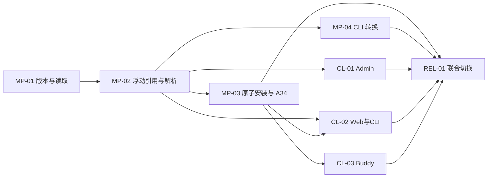

# 开发 issues 与依赖关系（B 模型）

> **执行基线更新（2026-10-26）：** 已重新查询 GitHub 并 fetch：当前 main 为 `eec5223`，已合入 #124/#125/#128；#126 已关闭，#127 仍开放。下文旧状态表保留核验历史，不作为本轮施工基线。后续工作从已合并代码增量改造，既有版本/release/refs/attempt/migration 代码复用；任务及 PR 追踪见 execution.md。

这些是可直接复制到 issue tracker 的本地开发说明，不是已创建的远程 issue，也不是强制“一 issue 一 PR”。8 个 issue 按可独立验收的能力和仓库边界组织；Marketplace 主干只有 4 个，不再沿原 14 个 PR 编号逐项执行。

**状态（2026-10-26）：决策已锁定，按 B 模型执行。** Expert→Skill、Team→Expert 在每次读取/安装时解析目标当前正式发布版，`target_version_id` 只作上次解析/审计值；Connector 按 ID 读 effective；A01/A03/A34/安装/审核共用一个最新解析服务，每次请求各自使用一致性快照；最新版不可用时不回退旧版。A09 restore、A29/A30 HTTP 迁移、同名/多版本共存、“曾发布即禁止删除”均已明确不做。完整口径见 [00-decisions](../00-decisions.md) 与 [2026-10-26 决策记录](../decisions-20261026.md)；本文只负责执行切片，接口语义以 [API 契约](../02-api-contracts.md) 为准，文档冲突先改 00/02 再改代码。

## 0. 当前代码基线与 PR 映射

当前基线为 `origin/main 59ca051`（#124/#125 已合入）；核验快照中的 #126/#127/#128 均为开放 PR，#128 是 #126 替代候选，**不能按现状合并**，需先按本目录的 B/D 口径改造。

| PR | 状态 | 实际交付 | 与本方案的差距 / 处理 |
|---|---|---|---|
| #124 `52e4d91` | 已合入 | 版本/发布底座：快照、release/published、SemVer | 保留底座；补 `edit_revision` CAS、relations 必填、Connector effective、读投影；不补 A09/`restored_from_version_id`。 |
| #125 `c9d2a84` | 已合入 | 引用/审核/删除保护骨架 | 保留 refs/rereview 骨架；改为浮动最新解析（`target_version_id` 仅审计）、删除保护并集（去掉曾发布总禁令）、同 owner private→private 允许、Connector observations。 |
| #126 `e7ffc79` | 开放 | 固定版本安装、盘点/迁移 CLI | **不按现状合并**：A31/A32 两套执行器、重试重读 live、指针回滚、`mk1` 改名、迁移无冻结 `plan_digest`。按 MP-03/MP-04 重做。 |
| #127 `016baef` | 开放 | 公共列表按依赖过滤（SQL 前置/COUNT/facets） | **不按现状合并**：`dependency_issues` 旧 DTO、只诊断 pin、无 `view`/四字段/匿名聚合/editing 根。保留 SQL 前置思路，按 D4/B 重做。 |
| #128 `3467a39` | 核验时开放，#126 替代候选 | inline 负校验、锁前文件冻结、readiness SQL、过期回执说明 | 保留这些修复；MP-02 改 pin/Connector 和权限，MP-03 替换 legacy/重解析 attempt/mk1，MP-04 去掉指针回滚并补冻结授权计划，REL-01 复用 readiness/回执手册并实测。 |

以上是 2026-10-26 核验快照，不是实时状态；实施前复核 head/merge。#126/#128 按替代关系选基线，禁止重复引入。已有 release/refs/attempt 表复用，plan 的 owns_new_tables 保留原 schema 字段名、表示本方案表职责，DDL 只提交实际缺失增量。文档五组修订完成，代码与运行验收尚未完成。

## 1. 交付切片与硬依赖

硬依赖表示该 issue 完成验收所需前置能力；可以提前按确定契约编码，不代表前置未完成时可以启用。唯一机器可读来源为 [plan.json](../plan.json)；接口语义以 [API 契约](../02-api-contracts.md) 为准。

| Issue | 可执行说明 | 完成硬依赖 | 主要仓库 | 完成交付 |
|---|---|---|---|---|
| MP-01 | [版本、发布与统一读取](01-version-publication.md) | 无 | marketplace | 不可变文件/current-published/release/Connector effective/CAS 与 relations/读投影/A01 四字段 DTO 底座；无 A09 |
| MP-02 | [浮动引用、最新解析与审核治理](02-dependency-governance.md) | MP-01 | marketplace | 唯一最新解析服务/引用写入与矩阵/审核观察/live∪published∪Team→最新发布 Expert 间接保护/容器/候选与影响；A01 公共 SQL 过滤、COUNT/facets、mine 四字段安全诊断 |
| MP-03 | [原子安装、A34 与安全重试](03-installation-fleet.md) | MP-02 | marketplace（联调依赖现有 Fleet） | A31/A32/A34 唯一端点 owner；A34 单 GET 最新完整内容/一个安装引擎/同 key 原 plan/新 key 最新/状态机与 UNKNOWN；同名冲突失败 |
| MP-04 | [CLI 转换与数据安全回滚](04-migration.md) | MP-02 | marketplace | CLI 两次 preview/冻结 `plan_digest`/apply 只认冻结计划/映射/waiting_review/数据安全回滚；不调用 Fleet |
| CL-01 | [Admin 接入](05-admin.md) | MP-02 | admin | schema2 ZIP-only/A25 Key+CAS+`resolved[]`/只读解析预览/effective 读取；沿用现有发布审核动作 |
| CL-02 | [Web 与 CLI 接入](06-web-cli.md) | MP-02、MP-03 | web、cli | 显式引用+CAS/审核/版本读取/A34 一次最新完整内容/CLI 查询/mine 四字段标记与匿名 Tooltip/同 key 原 plan、新 key 新安装 |
| CL-03 | [Buddy 接入](07-buddy.md) | MP-03 | buddy-client | 单 A34 最新完整内容、无依赖补取、无 BFS/无字节改写/本地读取边界/工作空间招募与安全重试 |
| REL-01 | [四端证据与干净切换](08-cutover.md) | MP-03、MP-04、CL-01、CL-02、CL-03 | 全部涉及仓库 | 真实数据层/四端/Fleet/Daemon 证据；部署门禁使旧执行器不可达；数据安全回滚；B/A01/D4 真实证据 |

## 2. 哪些先做，哪些并行

1. **第一步 MP-01**：先拿到不可变版本、文件、正式发布身份、Connector effective、CAS 和读投影。此时各端可按确定 API 写类型/界面，但不得猜当前后端行为或启用新协议；本步不实现依赖解析，也不补 A09。
2. **第二步 MP-02**：建立唯一的“最新发布解析”领域服务和共享 `refs`/审核观察/删除保护，接入 A01 公共过滤与 mine 诊断。**A01/A03/A34/安装/审核必须共用这一实现**，任何调用点不得再写第二套“最新版”判断。此步完成后，B 的读取语义才可对外启用。
3. **MP-02 之后可并行完成 MP-03、MP-04、CL-01**：安装与 A34、CLI 转换、Admin 路径相互独立；共享 policy/codec/解析器只消费，不另建同义模型。Web/CLI 的发布/读取子工作可在 MP-03 前开发，A34 完整内容与真实安装验收等 MP-03。
4. **MP-03 之后 CL-02 和 CL-03 可并行完成**：Web/CLI 与 Buddy 独立目录，均只消费一次 A34 最新内容；不得用 A03、detail、versions、skill_md/download/files 扇出补内容。CLI/Web 同一个 Bot 发布流程归 CL-02，内部两个仓库可并行接类型、最后验证同一真实流程。
5. **最后 REL-01**：所有前置完成才放行生产切换。不是等最后才联调：MP-01 版本 smoke、MP-02 审核/解析/A01 smoke、MP-03 A34 单 GET 全内容/错误无裁剪/零 Fleet/零写入与同 key 原 plan 重试、MP-04 CLI 冻结计划演练、各 CL 实际 surface 验证均需实现阶段证据；当前未运行。

## 3. 共享文件与数据所有权

- **MP-01** 独占版本/release/effective/CAS 及版本文件基础、共享 codec、A01 endpoint 与 DTO 底座；不建依赖谓词、不建分发状态列、不建 A09/`restored_from_version_id`。
- **MP-02** 顺序扩展 `plugin_relations`/`plugin_version_relation_refs`（`target_version_id` 可空、仅审计）、审核观察、`plugin_mutation_receipts`，并建立**唯一** `LatestPublishedResolver`。`content_digest` 必须排除浮动 `target_version_id` 等解析值；同 digest 但标签/受众/关系身份变化仍建新快照。
- **A01** 唯一端点 owner 仍是 MP-01；MP-02 扩展共享 metadata 依赖谓词（公共分页/COUNT 前置，沿最新解析递归判定；Team 沿最新成员 Expert 再判 Skill/Connector），供分类 `plugin_count`、公共 tags 复用。`mode=mine` 不因依赖异常过滤，保留原 owner/Space 内非删除资产与 total，只对 Expert/Team 输出权限安全的 `dependency_availability`。不新增接口、治理状态或修改来源 `listing_state`；依赖恢复或来源发布新版本后下一次查询重算，无推送/轮询。
- **A34** 由 MP-03 独占 HTTP/DTO/完整内容组装，但解析必须调用 MP-02 的同一 resolver，并在同一一致性快照内完成；MP-02 不实现第二个 A34，也不得让安装/审核另写解析。A34 的 `bundle_digest` 在 B 下随最新依赖动态变化。
- **删除保护**（MP-02）统一为并集：live incoming（active 来源、未删除、不过滤 listing、含草稿）∪ published refs（按 `target_plugin_id`）∪ Team→最新发布 Expert→Skill/Connector 间接引用；**没有“曾发布即禁止删除”总禁令**。只改删除，不改已发布资源收窄 visibility 的现有行为；引用式来源删除只删自身及自身关系，不删共享目标。
- **依赖矩阵**（MP-02）：system 仅引用已发布 system；space 仅引用已发布 system 或同 Space 的 space；同 owner private→private 允许；space/system 不得引用 private；跨 Space 禁止；Admin 可见不绕过。最新解析依赖下架/删除/缺失时，Expert/Team 公共隐藏且 A34/安装整体失败；owner 只能看到 mine 诊断，不能安装坏图。不新增下架依赖安装豁免，不回退旧版。
- **CL-02** 拥有 Web wire/domain 类型与全部/专家/专家团 tab 的 `MineRow/MineTable` 标记、固定 reason i18n 和 hover/键盘 focus Tooltip；全部 tab 的 `getMySkills` 跨类型通路不可遗漏，不在前端过滤或扇出查依赖/A34。
- **MP-04** 只扩展 `plugin_mutation_receipts` 的 operation 使用并创建 migration map；CL-01 不建后端表。MP-04 与 MP-03 并行期间不得同时改同一 policy 算法；安装结果对比在 REL-01 验证。
- **MP-03** 独占 A31/A32/A34 端点、DTO、完整内容读取组装，以及 attempt/plan 和网络安全重试；复用 MP-01 文件与 MP-02 resolver，抽出不依赖 Runtime/Workspace/Secret 的内容组装。A31/A32 共用唯一 `InstallCoordinator`；A32 保留 URL、不保留旧行为；删除市场 legacy create/bind/delete 补偿。客户端只保存无 Secret 防重复/人工核对元数据，不增加远端结果查询，不修改 Fleet receipt/action/cleanup/过期重占。
- **CL-03** 只拥有 Buddy 主进程 adapter、最小无 Secret pending 记录、IPC 类型与现有 UI 状态；完整内容只消费一次 A34，删除 BFS 补取与 `normalizeMarketplaceSkillMarkdown`/ZIP 补文件等字节改写；不改 Fleet/Daemon。
- **同名/多版本**：本期拒绝共存，同名不同内容安装冲突失败；普通安装保留市场原名/原字节；不生成 `mk1` 别名、不改写 `SKILL.md` frontmatter、不改目录名、不改 Fleet/Daemon。
- OpenAPI 生成物由每个实际端点 owner 同步；前端不手写第二份服务端规范。CL-02 安装部分依 MP-03，不能先发布读写部分就宣布整个 issue 完成。
- 客户端仅消费既有权限/上下架与新解析图；保留非默认场景投放可见性且 default 不可隐藏。缺依赖明确失败；历史权限隔离与快照/文件证据保留。issue 数量、硬依赖、表和客户端 owner 不变。

## 4. 相对原 14 个 PR 的收敛

原 V1/V2 合并到 MP-01；R1～R4 合并到 MP-02；I1～I4 的实现和早期运行证明并入 MP-03；M1～M3 的工具、映射和恢复合到 MP-04（改为 CLI）；原 M4 最终验收进入 REL-01。原计划外部另算的客户端工作显式纳入 CL-01/02/03，不再藏在“后续协作”中。

减少的是人为阶段拆分，不减少功能与验收。需要多仓库 PR 时按仓库提交，但追踪同一 issue 的完成条件；不要为了凑 issue 数量把权限、索引或失败恢复漏掉。

## 5. 明确不做

- A09 restore-to-draft；任何 `restored_from_version_id` 写入或恢复验收。
- A29/A30 HTTP 迁移；生产迁移只经 MP-04 CLI + 离线授权。
- 同名/多版本共存、`mk1` 命名、frontmatter 改写、Fleet/Daemon 改造。
- “曾发布即禁止删除”总禁令；删除只按并集保护。
- 新生命周期状态、新审核角色、下发式回退旧版本。
